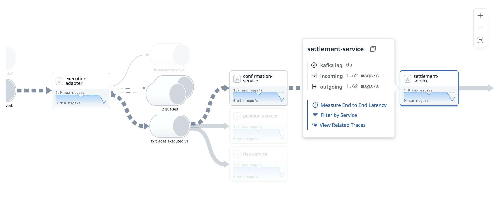
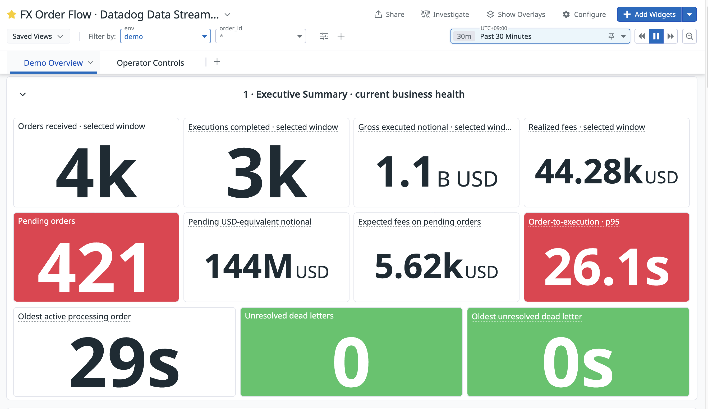
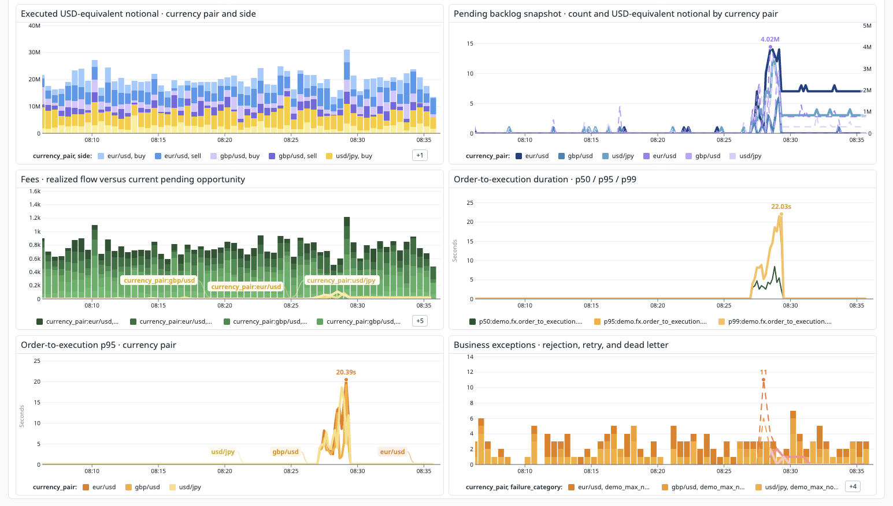
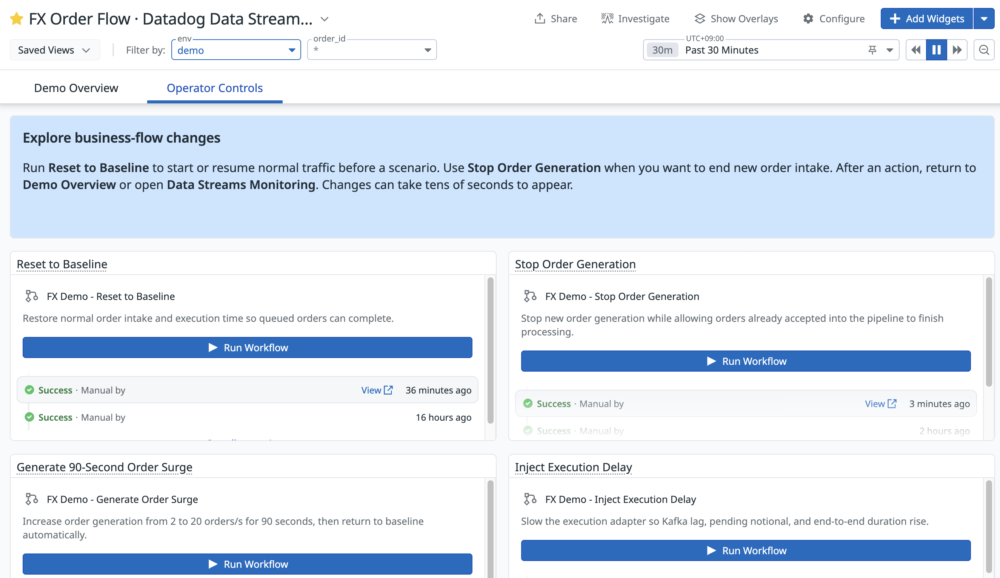

# Datadog Data Streams Monitoring デモ



[English](README.md)

Datadog Data Streams Monitoring（DSM）は、イベント駆動型 Application の
Producer、Topic、Consumer を Map 上に表示し、経路 Latency、Throughput、
Consumer lag を計測します。Message の遅延や滞留がどこで発生し、どの Service が
関係しているかを特定するための手掛かりを提供します。

このプロジェクトは、Kafka を利用した Java Application に DSM、APM、ログ、
Custom Metrics を計装する方法を示すデモです。`USD/JPY`、`EUR/USD`、`GBP/USD` の
架空の FX 注文を継続的に処理します。Kafka は知っているものの、Datadog による
可観測性は初めて、という開発者を主な対象にしています。

> [!IMPORTANT]
> これは個人が作成した学習用プロジェクトであり、Datadog 公式サンプルでも
> 本番環境の参照 Architecture でもありません。実際の市場データ、顧客情報、
> 口座情報、注文、約定は使用していません。価格、Exposure、Fee もすべて
> デモ用の架空値です。

## 学べること

- Datadog Java tracer による Kafka Producer／Consumer 経路の計装
- DSM による経路 Latency、Throughput、Consumer lag の関連付け
- Unified Service Tagging による DSM、APM、ログ、Kubernetes の相関
- 高 Cardinality な Metrics を作らずに注文 Context を検索する方法
- Retry Topic、Dead Letter Topic、Redrive が DSM 上でどのように見えるか
- Streaming Backlog の影響を業務 Metrics で説明する方法

各計装方式と Datadog 上の表示の関係は、
[Datadog 学習ガイド](docs/datadog-learning-guide.md) で説明しています。

## デモに含まれるもの

Application は 10 個の Spring Boot Service、Strimzi が管理する 9 個の Kafka
Topic、PostgreSQL Projection で構成されます。付属の Datadog Terraform は、
Dashboard、2 個の Monitor、Metric Metadata と Tag Configuration、APM Retention
Filter、任意の 6 個の Workflow Automation Control を作成します。

デプロイ後は次の操作と観察ができます。

- DSM で注文処理 Topology と Kafka の状態を確認する
- 業務状態を経路 Latency、lag、Trace、ログと関連付ける
- Traffic、Delay、Failure、Recovery、Redrive のシナリオを実行する
- 1 個の `order_id` から Event、Span、Retry、最終結果を追跡する

### デモ概要

[](docs/images/datadog-dashboard-demo-overview.png)

*執行遅延シナリオ中は Pending Order と Order-to-execution Latency が上昇し、
Dead Letter は 0 のままです。*

<details>
<summary>業務フローの詳細 Chart を表示</summary>

[](docs/images/datadog-dashboard-business-flow-details.png)

*詳細 Chart では Throughput、Backlog、Latency、Notional、架空の Fee、
業務 Exception の関係を確認できます。*

</details>

### Operator Controls

[](docs/images/datadog-dashboard-operator-controls.png)

*Workflow Automation は Agent-based Private Action Runner を通じてシナリオを
実行します。Control Endpoint は ClusterIP 限定です。*

Kubernetes Context を検証する `scripts/demo-control` CLI を使用すれば、Workflow
Automation なしでも同じ操作を実行できます。Dashboard の Button を有効にする
手順は [Private Action Runner ガイド](docs/private-action-runner.md) を参照してください。

## アーキテクチャ

[詳細アーキテクチャ図](docs/architecture.md#system-and-observability-flow) では、
すべての Service、Kafka Topic、永続化、Datadog の計装、Telemetry 送信経路を
確認できます。

Java 21、Spring Boot、Spring for Apache Kafka、Apache Avro、KRaft Mode の
Strimzi Kafka、PostgreSQL、Helm、AWS CDK、Datadog Terraform Provider を
使用しています。ローカル Container Runtime は Podman で検証し、Release Image は
GitHub Actions で Build します。

## セットアップ

次のいずれかの Kubernetes 環境を選択します。どちらも同じ Application と Datadog
学習体験を提供します。

| デプロイ先 | 環境 | Kafka と Storage |
|---|---|---|
| kind | ローカル Kubernetes | Kafka 1 Node、開発用 Storage |
| Amazon EKS | AWS アカウントの Kubernetes | Kafka 1 Node、永続 EBS Storage |

どちらも、このリポジトリが Build した Public な Multi-architecture GHCR Release
Image をデフォルトで使用します。Deploy Script は不変の Digest を使用する前に、
Release Image Lock の GitHub Artifact Attestation を検証します。Private ECR は
不要です。Provenance、外部 Image、任意の Self-build 手順は
[Container Image の方針](docs/container-images.md) を参照してください。

どちらも Bash、kubectl、Helm、curl、jq、GitHub CLI、Datadog の API／Application
Key が必要です。Windows では WSL2 を使用してください。ローカル環境では kind、
OpenSSL、Podman 6 以降も必要です。JDK 21 は Host 上で Java Test を実行する場合だけ
使用します。未検証の Docker 置換手順は
[Runbook](docs/demo-runbook.md#docker-compatibility-note-not-tested) に記載しています。

`DD_API_KEY`、`DD_APP_KEY`、`DD_SITE` は Password Manager または Secret Manager
から実行時に読み込んでください。解決済みの Key をリポジトリや Shell History に
保存しないでください。

Release Image と確認済みの Third-party Image は Linux AMD64／ARM64 に対応しています。
どちらの Deployment Option でも Kubernetes が Node に合う Image を自動選択します。

### ローカル Kubernetes（kind）

```bash
export FX_DEMO_RELEASE="v0.1.0"
gh auth status
scripts/kind-up
scripts/kind-deploy
scripts/smoke-test kind
```

デプロイ後は DSM を `env:local` で絞り込みます。Smoke Test は注文を 1 件送信し、
`SETTLEMENT_INSTRUCTED` へ到達するまで確認します。

変更した Application Image をローカルで Build する場合:

```bash
scripts/build-images
FX_DEMO_IMAGE_SOURCE=self-built scripts/kind-deploy
```

### Amazon EKS

> [!WARNING]
> EKS は課金対象の AWS リソースを作成し、Datadog へ Telemetry を送信します。
> 1 台の On-demand Worker、Control Plane、1 台の NAT Gateway、EBS Volume は
> Teardown まで課金対象です。Data Plane は Cost を抑えた Single-AZ 構成であり、
> 高可用性を備えた本番用 Topology ではありません。

EKS では、認証済み AWS CLI、Node.js、npm、明示的な管理者 CIDR と IAM Role、
PostgreSQL Credential も必要です。Infrastructure 作成、Deploy、Datadog Terraform、
検証、Teardown の完全な手順は [デモ Runbook](docs/demo-runbook.md) に記載しています。

Runbook に従って AWS と Credential を準備した後:

```bash
export FX_DEMO_RELEASE="v0.1.0"
scripts/deploy eks
scripts/smoke-test eks
```

自分で Build する場合は、10 個の Service Image を EKS から取得可能な Registry へ
Push し、生成された Digest Lock を `FX_DEMO_IMAGE_SOURCE=self-built` で選択します。
Command と Trust Boundary は
[Runbook](docs/demo-runbook.md#4-select-application-images) を参照してください。

## Datadog で確認できること

| 画面 | このデモで確認できること |
|---|---|
| Data Streams Monitoring | Service／Topic Topology、経路 Latency、Throughput、Consumer lag |
| APM とログ | 検索可能な注文 Context と、影響を受けた経路からの Drill-down |
| Dashboard と Metrics | Pending Order、Notional、Fee、Duration、Retry、Dead Letter |
| Workflow Automation | 再現可能なシナリオ操作と実行履歴 |

Datadog Admission Controller がバージョンを固定した Java tracer を注入します。
Tracer は対応する Kafka Client を自動計装し、Trace と DSM Pathway Context を
伝播します。Application Code が DSM Checkpoint を手動で作成する必要はありません。

`order-state-service` は全 Lifecycle Topic を消費し、主要な経路を見づらくするため、
デフォルトではこの Service だけ DSM を無効にしています。すべての Consumer を
表示する場合は、デプロイ前に `FX_DEMO_DSM_FULL_TOPOLOGY=true` を設定してください。
構造化ログと Active Span には注文調査に必要な Context を付加し、Unique ID は
Metric Tag に使用しません。

計装の対応関係、DSM と APM の違い、Retry Header の伝播、Metric の出所は
[Datadog 学習ガイド](docs/datadog-learning-guide.md) を参照してください。

## デモシナリオ

Dashboard の **Operator Controls** または CLI Fallback を使用します。

```bash
scripts/demo-control <kind|eks> <baseline|stop|surge|delay|failure|redrive>
```

基本シナリオでは Baseline Traffic を開始し、執行遅延を注入します。Kafka lag、
Pending Order、業務 Duration を関連付け、影響を受けた経路を特定した後、Recovery を
観察します。拡張シナリオでは、指定された 10 件を 2 個の Retry Topic と Dead Letter
Topic へ送り、未解決 Order を Redrive します。

実行内容、観察場所、期待する変化は
[demo-presentation-steps.md](docs/demo-presentation-steps.md) を参照してください。

## ドキュメント

| Document | 内容 |
|---|---|
| [Architecture](docs/architecture.md) | System、Kafka、永続化、Telemetry の設計 |
| [学習ガイド](docs/datadog-learning-guide.md) | DSM の読み方と APM、ログ、Metrics との関係 |
| [デモ Runbook](docs/demo-runbook.md) | Deploy、Operation、検証、Teardown |
| [Container Image の方針](docs/container-images.md) | Image の取得元、Provenance、Digest 方針 |
| [Private Action Runner](docs/private-action-runner.md) | Dashboard Workflow Control の設定 |

Source Code は `apps/`、Kubernetes 設定は `deploy/`、AWS／Datadog Infrastructure は
`infra/`、操作 Command は `scripts/` に配置しています。

Datadog 公式ドキュメント:

- https://docs.datadoghq.com/data_streams/
- https://docs.datadoghq.com/data_streams/setup/technologies/kafka/
- https://docs.datadoghq.com/tracing/trace_collection/dd_libraries/java/
- https://docs.datadoghq.com/actions/private_actions/

Schema Tracking の参考情報は
https://docs.datadoghq.com/data_streams/schema_tracking/ を参照してください。このデモは
Schema Registry をデプロイせず、Schema Tracking が利用できない場合も動作します。

## サポートとライセンス

質問と不具合報告は GitHub Issues で受け付けます。Pull Request は受け付けません。
Issue には認証情報、顧客情報、本番 Payload、未加工のログを含めないでください。
[CONTRIBUTING.md](CONTRIBUTING.md) を確認し、脆弱性は
[SECURITY.md](SECURITY.md) に従って非公開で報告してください。

[MIT License](LICENSE) で公開します。
