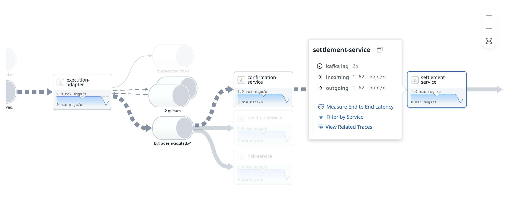
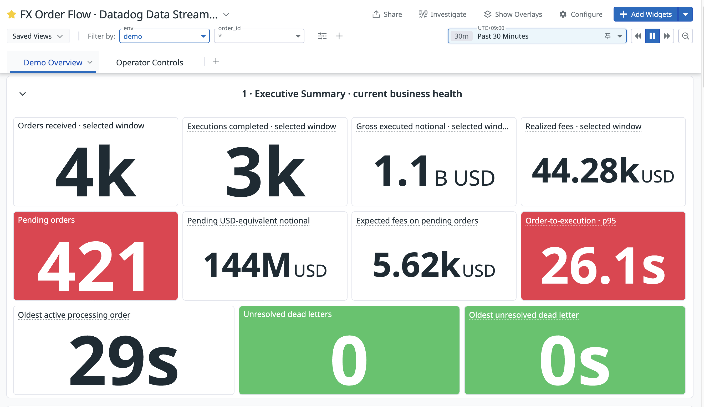
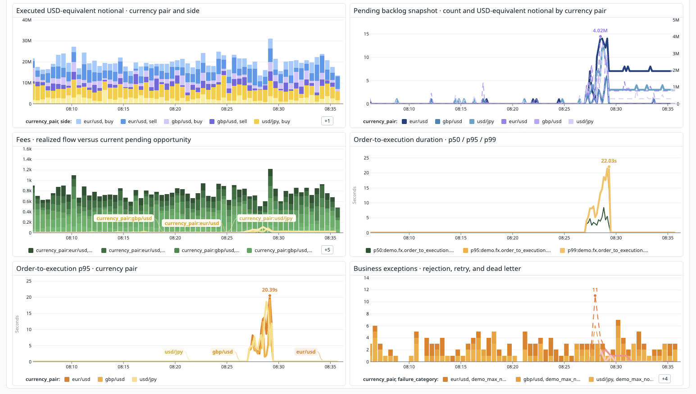
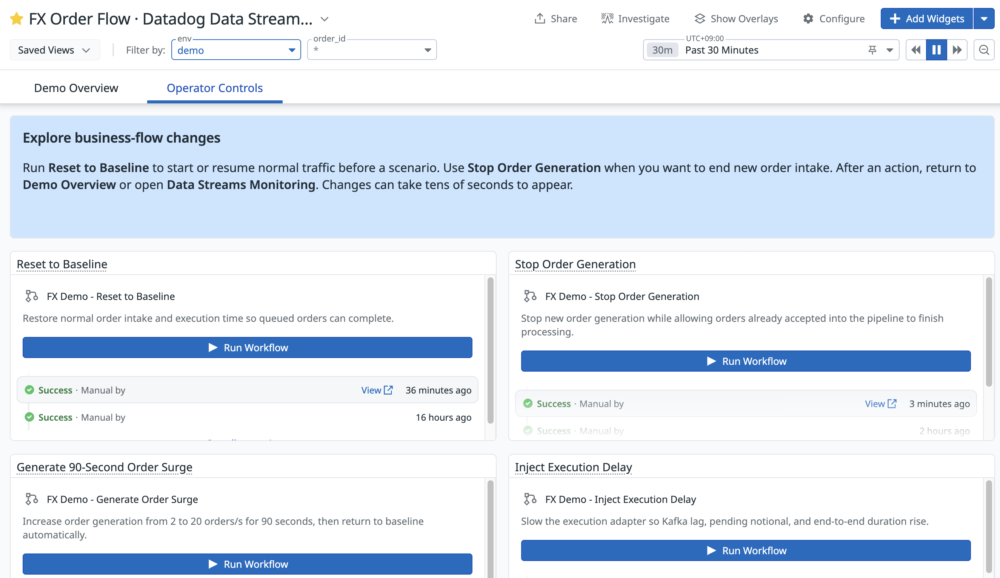

# Datadog Data Streams Monitoring Demo



[日本語](README.ja.md)

Datadog Data Streams Monitoring (DSM) maps producers, topics, and consumers in
event-driven applications and measures pathway latency, throughput, and
consumer lag. It helps identify where messages slow down or accumulate and
which service is involved.

This project demonstrates how to instrument a Kafka-based Java application
with DSM, APM, logs, and custom metrics. It continuously processes fictional
FX orders for `USD/JPY`, `EUR/USD`, and `GBP/USD` and is intended for developers
who know Kafka but are new to Datadog observability.

> [!IMPORTANT]
> This is an independent learning project, not an official Datadog sample or a
> production reference architecture. It uses no real market, customer,
> account, or trading data. All orders, prices, executions, exposures, and fees
> are generated and fictional.

## What you can learn

- How the Datadog Java tracer observes Kafka producer and consumer pathways
- How DSM relates pathway latency, throughput, and consumer lag
- How unified service tags correlate DSM, APM, logs, and Kubernetes workloads
- How to propagate searchable order context without high-cardinality metrics
- How retry topics, a dead-letter topic, and redrive appear in DSM
- How business metrics explain the impact of a streaming backlog

Use the [Datadog learning guide](docs/datadog-learning-guide.md) to connect each
instrumentation mechanism to what appears in Datadog.

## What the demo includes

The application contains ten Spring Boot services, nine Kafka topics managed
by Strimzi, and PostgreSQL projections. The included Datadog Terraform creates
a dashboard, two monitors, metric metadata and tag configurations, an APM
retention filter, and—when enabled—six Workflow Automation controls.

After deployment, you can:

- Explore the order-processing topology and Kafka health in DSM
- Correlate business status with pathway latency, lag, traces, and logs
- Trigger repeatable traffic, delay, failure, recovery, and redrive scenarios
- Follow one `order_id` through its events, spans, retries, and final outcome

### Demo Overview

[](docs/images/datadog-dashboard-demo-overview.png)

*Pending orders and order-to-execution latency rise during an execution-delay
scenario while dead letters remain at zero.*

<details>
<summary>View detailed business-flow charts</summary>

[](docs/images/datadog-dashboard-business-flow-details.png)

*Detailed charts relate throughput, backlog, latency, notional, synthetic
fees, and business exceptions.*

</details>

### Operator Controls

[](docs/images/datadog-dashboard-operator-controls.png)

*Workflow Automation triggers repeatable scenarios through an Agent-based
Private Action Runner. The control endpoints remain ClusterIP-only.*

The context-validating `scripts/demo-control` CLI provides the same controls
without Workflow Automation. See the [Private Action Runner guide](docs/private-action-runner.md)
to enable the dashboard buttons.

## Architecture

See the [detailed architecture diagram](docs/architecture.md#system-and-observability-flow)
for all services, Kafka topics, persistence, instrumentation, and telemetry
paths.

The stack uses Java 21, Spring Boot, Spring for Apache Kafka, Apache Avro,
Strimzi Kafka in KRaft mode, PostgreSQL, Helm, AWS CDK, and the Datadog
Terraform Provider. Podman is the tested local container runtime; GitHub
Actions builds release images.

## Getting started

Choose either Kubernetes target. Both run the same application and provide the
same Datadog learning experience.

| Target | Environment | Kafka and storage |
|---|---|---|
| kind | Local Kubernetes | One Kafka node and development storage |
| Amazon EKS | Kubernetes in your AWS account | One Kafka node and persistent EBS storage |

Both targets default to public multi-architecture GHCR release images built by
this repository. The deployment scripts verify the release image lock's GitHub
Artifact Attestation before using its immutable digests. No private ECR
repository is required. See the [container image policy](docs/container-images.md)
for provenance, third-party images, and the optional self-build path.

Both paths require Bash on macOS or Linux, kubectl, Helm, curl, jq, the GitHub
CLI, and a Datadog API/Application Key pair. Windows users should use WSL2.
The local path additionally requires kind, OpenSSL, and Podman 6 or later.
JDK 21 is needed only for host-side Java tests. Untested Docker substitutions
are described in the [runbook](docs/demo-runbook.md#docker-compatibility-note-not-tested).

Load `DD_API_KEY`, `DD_APP_KEY`, and `DD_SITE` at runtime from a password manager
or secret manager. Do not store resolved keys in the repository or shell
history.

The release and reviewed third-party images support Linux AMD64 and ARM64.
Kubernetes selects the matching image automatically for both deployment options.

### Local Kubernetes with kind

```bash
export FX_DEMO_RELEASE="v0.1.0"
gh auth status
scripts/kind-up
scripts/kind-deploy
scripts/smoke-test kind
```

After deployment, filter DSM to `env:local`. The smoke test submits one order
and waits for `SETTLEMENT_INSTRUCTED`.

To build modified application images locally instead:

```bash
scripts/build-images
FX_DEMO_IMAGE_SOURCE=self-built scripts/kind-deploy
```

### Amazon EKS

> [!WARNING]
> EKS creates billable AWS resources and sends telemetry to Datadog. One
> on-demand worker, the control plane, one NAT gateway, and EBS volumes remain
> billable until teardown. This single-AZ data plane is cost-conscious but is
> not a high-availability production topology.

The EKS path adds an authenticated AWS CLI, Node.js, npm, an explicit
administrator CIDR and IAM role, and PostgreSQL credentials. Follow the
[demo runbook](docs/demo-runbook.md) for infrastructure creation, deployment,
Datadog Terraform, validation, and teardown.

After the runbook's AWS and credential setup:

```bash
export FX_DEMO_RELEASE="v0.1.0"
scripts/deploy eks
scripts/smoke-test eks
```

Users who build their own images can push all ten services to a registry
reachable by EKS and deploy the generated digest lock with
`FX_DEMO_IMAGE_SOURCE=self-built`. The complete commands and trust implications
are documented in the [runbook](docs/demo-runbook.md#4-select-application-images).

## What to observe in Datadog

| View | What this demo shows |
|---|---|
| Data Streams Monitoring | Service/topic topology, pathway latency, throughput, and consumer lag |
| APM and logs | Searchable order context and drill-down from an affected pathway |
| Dashboard and metrics | Pending orders, notional, fees, duration, retries, and dead letters |
| Workflow Automation | Repeatable scenario controls and execution history |

The Datadog Admission Controller injects a pinned Java tracer. It automatically
instruments supported Kafka clients and propagates trace and DSM pathway
context; application code does not create DSM checkpoints manually.

DSM is enabled for every application except `order-state-service` by default,
because that projection consumes every lifecycle topic and can obscure the
primary path. Set `FX_DEMO_DSM_FULL_TOPOLOGY=true` before either deployment to
include it. Structured logs carry order and event context, while bounded
attributes on active spans support order-level investigation without using
unique IDs as metric tags.

See the [Datadog learning guide](docs/datadog-learning-guide.md) for the full
instrumentation map, DSM/APM differences, retry-header propagation, and metric
sources.

## Demo scenarios

Use the dashboard's **Operator Controls** or the CLI fallback:

```bash
scripts/demo-control <kind|eks> <baseline|stop|surge|delay|failure|redrive>
```

The core walkthrough starts baseline traffic, injects execution delay,
correlates Kafka lag with pending orders and business duration, identifies the
affected pathway, and then observes recovery. The extended walkthrough sends
exactly ten marked orders through both retry topics and the dead-letter topic
before redriving all unresolved orders.

See [demo-presentation-steps.md](docs/demo-presentation-steps.md) for what to
run, where to look, and what change to expect.

## Documentation

| Document | Purpose |
|---|---|
| [Architecture](docs/architecture.md) | System, Kafka, persistence, and telemetry design |
| [Learning guide](docs/datadog-learning-guide.md) | How to read DSM and relate it to APM, logs, and metrics |
| [Demo runbook](docs/demo-runbook.md) | Deployment, operation, validation, and teardown |
| [Container image policy](docs/container-images.md) | Image sources, provenance, and digest policy |
| [Private Action Runner](docs/private-action-runner.md) | Dashboard workflow-control setup |

Source code is under `apps/`, Kubernetes configuration under `deploy/`, AWS and
Datadog infrastructure under `infra/`, and operator commands under `scripts/`.

Official Datadog references:

- https://docs.datadoghq.com/data_streams/
- https://docs.datadoghq.com/data_streams/setup/technologies/kafka/
- https://docs.datadoghq.com/tracing/trace_collection/dd_libraries/java/
- https://docs.datadoghq.com/actions/private_actions/

Schema Tracking background is available at
https://docs.datadoghq.com/data_streams/schema_tracking/. This demo does not
deploy a Schema Registry and remains functional when Schema Tracking is
unavailable.

## Support and license

Questions and bug reports are accepted through GitHub Issues; pull requests
are not accepted. Do not include credentials, customer information, production
payloads, or unsanitized logs. See [CONTRIBUTING.md](CONTRIBUTING.md) and report
security vulnerabilities privately as described in [SECURITY.md](SECURITY.md).

Licensed under the [MIT License](LICENSE).
