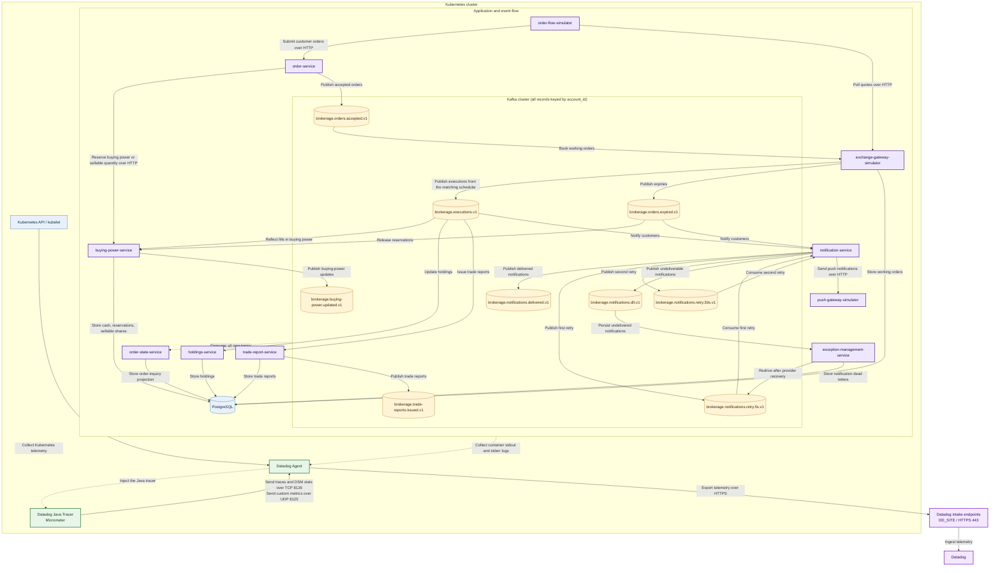

# Architecture

## Purpose and boundaries

This project is a Kafka demo designed to make Datadog Data Streams
Monitoring, APM, logs, and business metrics easy to study together. It models
the order and buying-power (買付余力) flow of a retail online brokerage
(ネット証券) trading Japanese cash equities, so the events and failure modes
are recognizable to people who build such systems. It is not a trading
platform, an order management system, or a reference for exchange
connectivity.

All instruments, accounts, prices, quantities, orders, executions, and
notifications are generated and fictional:

- Five fictional instruments, `D101` to `D105`. `D105` (Demo Semiconductor,
  base price 12,500 yen) is the target of the sell-off scenario.
- 500 fictional accounts, `A00001` to `A00500`. The first 450 are regular
  accounts with cash and holdings. The last 50 (`A00451` to `A00500`) are
  cash-poor switch traders: they start with no cash, so they can buy only
  after the proceeds of a sale have been reflected in their buying power.

There is no real market data, customer, exchange connection, or payment rail.

## System and observability flow



The nine cylinder-shaped nodes are topics in one Kafka cluster. Solid arrows
show application data or telemetry movement. Dashed arrows show injection or
collection rather than a business event flow.

Executions and expiries are produced by the exchange simulator's matching
scheduler, not inside the consumer that books the order. A real exchange is an
external system whose execution reports arrive independently of the customer's
order request, so DSM pathways and APM traces for the execution fan-out start
at `exchange-gateway-simulator`. Correlation across that boundary uses
`order_id` and `account_id`, which every event carries and which appear in
logs and span attributes.

### Application components

| Component | Role |
|---|---|
| `order-flow-simulator` | Simulates customer app traffic: baseline orders, the opening rush, the `D105` sell-off, and switch trades (sell, then buy with the proceeds). Polls quotes from the exchange simulator so limit prices stay inside the daily price limit. |
| `order-service` | Customer order API (`POST /orders`). Validates symbol, 100-share trading unit, tick size, and daily price limit; synchronously reserves buying power or sellable quantity; publishes accepted orders. Rejections are returned to the caller and never reach Kafka. |
| `buying-power-service` | Owns cash, reservations, and sellable quantity per account. Serves the synchronous reservation API, applies executions and expiries from Kafka, and publishes buying-power updates. Hosts the reflection-delay control. |
| `exchange-gateway-simulator` | Stands in for the exchange. Keeps the working-order book, matches on a 250 ms scheduler with partial fills, runs the opening auction (板寄せ) and the news-driven sell-off down to limit-down (ストップ安), and expires unfilled orders. |
| `holdings-service` | Holdings projection: shares and average cost per account and symbol. |
| `trade-report-service` | Trade reports (取引報告書) with trade date and settlement date (T+2 JPX business days) and zero commission. |
| `notification-service` | Execution and expiry notifications to customers through the push gateway, with a 5-second retry topic, a 30-second retry topic, and a dead-letter topic (DLT). |
| `push-gateway-simulator` | Stub for an external push provider. Deduplicates by `notification_id` and has an outage control that returns HTTP 503. |
| `order-state-service` | Order-inquiry projection (accepted, partially filled, filled, expired) with the reflection status of every execution: buying power, trade report, and notification. Exposes the current-state gauges used by the dashboard. |
| `exception-management-service` | Persists undelivered notifications from the DLT and redrives all unresolved ones on request after the push provider recovers. |

## Synchronous and asynchronous boundary

The most important design decision is where Kafka sits.

| Path | Style | Reason |
|---|---|---|
| Customer order → buying-power or sellable-quantity check and reservation | Synchronous HTTP, before the order is accepted | A real order management system checks buying power in line. The customer learns immediately whether the order was accepted or rejected, and an accepted order already holds its reservation. |
| Exchange execution reports → buying power, holdings, trade reports, notifications, order inquiry | Kafka | Fan-out of execution data is where online brokers use asynchronous messaging, and where consumer lag reaches customers: sale proceeds that are not yet reflected, stale order inquiry, late notifications. |
| Retry, DLT, and redrive | Customer notifications only | A notification is idempotent by `notification_id`, so re-sending is safe. Orders are never automatically re-sent: re-submitting a stale order after the market has moved is a trading incident, not a recovery pattern. |

`order-service` calls `buying-power-service` at
`POST /internal/buying-power/reservations` before it publishes anything.

- `200 RESERVED`: the order is published to `brokerage.orders.accepted.v1` and
  the customer receives `202 ACCEPTED` with the reserved amount.
- `422 REJECTED`: the customer receives the reason
  (`INSUFFICIENT_BUYING_POWER`, `INSUFFICIENT_SELLABLE_QUANTITY`, or
  `UNKNOWN_ACCOUNT`). Nothing is published.
- Buying-power service unavailable: the customer receives
  `503 BUYING_POWER_UNAVAILABLE`.
- Kafka publish failure after a successful reservation: the reservation is
  released through the idempotent
  `POST /internal/buying-power/reservations/{orderId}/release` compensation and
  the customer receives `503 ORDER_PUBLISH_FAILED`.

Input errors (unknown symbol, quantity not a multiple of 100, limit price off
tick or outside the daily limit) return `400 INVALID_ORDER`. Every rejection
increments `demo.brokerage.orders.rejected` with a bounded `reason` tag and
writes an `ORDER_REJECTED` log line.

## Kafka topics and partitioning

| Topic | Producer | Consumer groups |
|---|---|---|
| `brokerage.orders.accepted.v1` | `order-service` | `exchange-gateway-simulator-v1`, `order-state-service-v1` |
| `brokerage.executions.v1` | `exchange-gateway-simulator` | `buying-power-service-v1`, `holdings-service-v1`, `trade-report-service-v1`, `notification-service-v1`, `order-state-service-v1` |
| `brokerage.orders.expired.v1` | `exchange-gateway-simulator` | `buying-power-service-v1`, `notification-service-v1`, `order-state-service-v1` |
| `brokerage.buying-power.updated.v1` | `buying-power-service` | `order-state-service-v1` |
| `brokerage.trade-reports.issued.v1` | `trade-report-service` | `order-state-service-v1` |
| `brokerage.notifications.delivered.v1` | `notification-service` | `order-state-service-v1` |
| `brokerage.notifications.retry.5s.v1` | `notification-service`, `exception-management-service` (redrive) | `notification-service-retry-5s-v1`, `order-state-service-v1` |
| `brokerage.notifications.retry.30s.v1` | `notification-service` | `notification-service-retry-30s-v1`, `order-state-service-v1` |
| `brokerage.notifications.dlt.v1` | `notification-service` | `exception-management-service-v1`, `order-state-service-v1` |

Every record on every topic is keyed by `account_id`.

- Buying power is per account. Executions, expiries, and reservation releases
  for one account must be applied in order, and keying by account keeps them
  on one partition.
- Keying by symbol would put every `D105` event on one partition during the
  sell-off and create a hot partition exactly when the system is under the
  most load. Account keys spread the same burst across partitions.
- Keying by order would lose per-account ordering between different orders of
  the same account, such as a switch trade's sell and the buy that depends on
  its proceeds.

## Order lifecycle and buying-power rules

- `ACCEPTED`: the order holds its reservation and is booked as a working order.
- `PARTIALLY_FILLED`: one or more fills have occurred. Each execution report
  carries `executedQuantity` for this fill and `cumulativeQuantity` and
  `leavesQuantity` after it. `executionSequence` starts at 1.
- `FILLED`: the last fill completes the order.
- `EXPIRED`: the remaining quantity expired. Reasons are `LIMIT_DOWN_UNFILLED`
  (sell orders left at the end of the sell-off) and `SESSION_CLOSE` (safety
  expiry of any order still working after 10 minutes).

Buying power is `cash - reserved`.

- A BUY reserves `price × quantity`, where the price is the limit price, or the
  daily upper limit for a market order.
- On each BUY fill, `buying-power-service` releases
  `reserved × executed / quantity` (the last fill releases the remainder),
  debits the executed amount, and adds the shares to sellable quantity so they
  can be resold the same day.
- A SELL reserves sellable shares. A SELL fill removes the shares and credits
  the executed amount to cash immediately, so sale proceeds can be reused the
  same day.
- An expiry releases the remaining reservation.

`order-state-service` records, for every execution, when buying power was
reflected, when the trade report was issued, and when the customer
notification was delivered. `GET /internal/orders/{orderId}` returns that
view, and the smoke test uses it to confirm end-to-end reflection.

## Telemetry paths

- The Datadog Admission Controller injects the pinned Java tracer into the
  Java application workloads. The tracer automatically instruments HTTP and
  Kafka.
- DSM is enabled for every service except `order-state-service` by default,
  because that projection consumes all nine topics and obscures the primary
  path. Set `BROKERAGE_DEMO_DSM_FULL_TOPOLOGY=true` before deployment to
  include it.
- `order-state-service` is the only consumer of
  `brokerage.buying-power.updated.v1`, `brokerage.trade-reports.issued.v1`, and
  `brokerage.notifications.delivered.v1`, so those topics end at their
  producers in the default DSM map. The full-topology setting adds the
  consumer edges.
- APM traces follow the synchronous path from `order-flow-simulator` through
  `order-service` and `buying-power-service` to the accepted-order produce and
  its consumers. Executions start new traces at the exchange simulator's
  matching scheduler.
- The Java tracer sends APM traces and DSM stats to the node-local Agent on TCP
  port 8126. Micrometer sends custom metrics through DogStatsD on UDP port 8125.
- Applications write structured logs to standard output. The node Agent tails
  the container log files and correlates them with injected trace and span IDs.
- The Agent sends telemetry over HTTPS port 443 to the intake endpoints selected
  by `DD_SITE`.

## Event contracts

- Avro schemas live in `apps/schemas/src/main/avro`. Maven generates
  SpecificRecord classes during the build.
- Every event carries `eventId`, `eventType`, `eventVersion`, `occurredAt`,
  `accountId`, `orderId`, `symbol`, `side`, and `demoScenarioId`.
- Prices are decimals with one fractional digit, yen amounts are decimals with
  no fractional digits, and quantities are share counts.
- Event timestamps are UTC instants. Trade dates are derived in `Asia/Tokyo`.
- Unique business identifiers appear in logs and spans, not metric tags.

## Delivery and idempotency

The demo uses at-least-once Kafka delivery.

- Producers wait for Kafka send completion before listener methods return.
- Derived event IDs are deterministic from the input event ID and output type.
  A redelivered input therefore produces the same downstream event ID, and the
  same `notification_id` for the same execution or expiry.
- Consumers that persist side effects claim the input `event_id` in their
  schema's `processed_events` table inside the same database transaction, so a
  redelivered execution is not applied to buying power or holdings twice.
- The push gateway deduplicates by `notification_id`, so a notification that
  the provider already accepted is not shown to the customer twice, even when
  it is retried or redriven.
- Redrive creates a new event ID while preserving the original `order_id` and
  `notification_id`, and marks the record with the `brokerage-redriven` header.

These measures reduce duplicate side effects, but they do not make the local
database transaction and Kafka publish atomic. The demo does not implement a
transactional outbox. A production system that must guarantee atomic state
changes and event publication should use an outbox, Kafka transactions, or an
equivalent design and test its failure recovery explicitly.

## Notification retry, DLT, and redrive

When the push gateway fails, `notification-service` routes the notification:

```text
brokerage.executions.v1 or brokerage.orders.expired.v1
  -> brokerage.notifications.retry.5s.v1
  -> brokerage.notifications.retry.30s.v1
  -> brokerage.notifications.dlt.v1
```

The retry listeners hold each record until its topic delay has elapsed since
the record was written. This blocking wait makes the 5-second and 30-second
hops visible on the demo timeline. It occupies consumer threads and is not a
production retry-scheduling pattern.

`exception-management-service` persists each DLT record. Redrive republishes
every currently unresolved notification to the 5-second retry topic with its
retry count reset to 0, and marks each row resolved only after Kafka
acknowledges the write. Calling it with no unresolved rows is a successful
no-op.

Orders, executions, and buying-power updates have no retry topic or DLT. A
failure on those paths is visible as consumer lag and errors in DSM and APM,
not as an automatic re-send.

## Runtime boundaries

| Layer | Responsibility |
|---|---|
| AWS CDK | Optional VPC, EKS, managed nodes, EBS CSI, and IAM access |
| Helm | Strimzi Kafka, PostgreSQL, Datadog Agent resource, and applications |
| Terraform | Datadog dashboard, monitors, metric configuration, APM retention filter, and Workflow Automation |
| kind | Local Kafka/PostgreSQL integration with Datadog export |

EKS and kind each use one KRaft broker/controller node, replication factor 1,
and minimum ISR 1. EKS topics have six partitions; kind uses three partitions
for local feedback. The `buying-power-service` and `notification-service`
listeners use consumer concurrency 3, so partition-level lag can differ
between targets.

## Market realism and deliberate simplifications

What follows the real Japanese market:

- Daily price limits (制限値幅) follow the TSE table of limit widths by base
  price. For `D105` at 12,500 yen the width is 3,000 yen, so the limit-down
  price is 9,500 yen.
- Limit prices must be on the standard TSE tick size (呼値の単位) for the
  price band.
- Orders are in the 100-share trading unit (単元株).
- A market BUY is reserved at the daily upper limit price, as online brokers do
  for market orders.
- Sale proceeds are reflected in buying power on the fill and can be reused the
  same day.
- Commission is zero, matching the domestic cash-equity pricing of major
  online brokers. `trade-report-service` reads it from `COMMISSION_JPY`
  (default `0`).
- Settlement is T+2 JPX business days. The cycle is `SETTLEMENT_CYCLE_DAYS`
  (default `2`, Helm value `tradeReport.settlementCycleDays`). The holiday list
  is `DEMO_MARKET_HOLIDAYS` (comma-separated ISO dates, Helm value
  `tradeReport.holidays`); when unset, a built-in
  calendar covers weekends, the Dec 31 to Jan 3 market holidays, and Japanese
  national holidays for 2026 and 2027.
- The opening auction (板寄せ) matches all pre-open orders at one price, and
  orders fill partially as well as fully.

What is deliberately simplified:

- Everything is fictional: instruments `D101` to `D105`, accounts, prices, and
  quantities.
- The demo trades continuously, regardless of the real TSE sessions
  (9:00–11:30 and 12:30–15:30 JST). There is no lunch break and no closing
  auction; the opening auction runs only when the opening-rush scenario
  triggers it. Session hours are not modeled at all, while holidays and the
  settlement cycle are configuration rather than code.
- An execution on a non-business day is booked to the next business day.
- Orders still working after 10 minutes expire with `SESSION_CLOSE` as a
  stand-in for the end of the trading day.
- At limit-down, sell orders do not fill until the sell-off window ends, and
  the remainder then expires with `LIMIT_DOWN_UNFILLED`. There is no
  proportional allocation (比例配分) at the close.
- There is no margin trading, no smart order routing (SOR), no FIX
  connectivity, and no order amendment or cancellation by customers.
- Retry delays use dedicated consumers and blocking waits for visible demo
  timing, not high-volume retry scheduling.
- One PostgreSQL instance is shared across service-owned schemas.
- There is no Schema Registry; Avro compatibility is checked in the build.
- The traffic seed reproduces the generated order sequence by emission count,
  not wall-clock scheduling or action timing.
- Local Terraform state is supported by default. Multiple operators should use
  encrypted, access-controlled remote state with locking.

## Datadog instrumentation

- Unified tags `env`, `service`, and `version` are applied to workloads,
  traces, logs, and custom metrics.
- The Datadog Admission Controller injects the pinned Java tracer.
- DSM is enabled on the primary business flow and the complete
  notification retry/DLT/redrive path. The state projection alone is disabled
  by default.
- Structured logs carry account, order, event, symbol, scenario, and retry
  context.
- Current-state gauges expose working orders, unreflected executions, and
  unresolved dead letters; distributions expose reflection delay, delivery
  delay, order-to-first-execution time, and fictional executed amounts in yen.
- Private Action Runner calls ClusterIP-only control services. The chart creates
  no Ingress or public LoadBalancer for demo-control endpoints.

See [Reading the demo in Datadog](datadog-learning-guide.md) for the
instrumentation matrix, DSM metric tags, default/full topology comparison, and
retry-header propagation behavior. See
[Agent-based Private Action Runner setup](private-action-runner.md) for why the
DatadogAgent resource configures both node and Cluster Agent runners.

## Security boundaries

- Datadog and PostgreSQL credentials are read from Kubernetes Secrets.
- Secret values are not accepted through Helm values or Terraform variables.
- The deployment script can construct Secrets from its process environment or
  verify Secrets provisioned by an external secret manager.
- The EKS public API endpoint requires an explicit administrator CIDR.
- The EKS administrator IAM role is supplied at deployment time.
- Containers run as non-root, use the runtime-default seccomp profile, disallow
  privilege escalation, and drop Linux capabilities.
