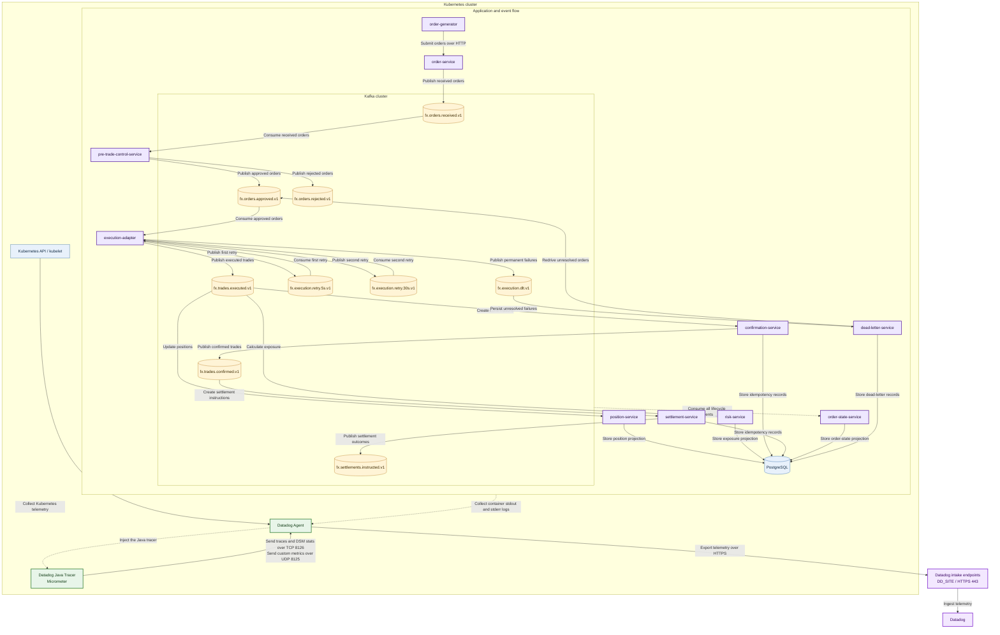

# Architecture

## Purpose and boundaries

This project is a Kafka order-processing demo designed to make Datadog Data
Streams Monitoring, APM, logs, and business metrics easy to study together.
The FX domain gives the events recognizable fields, but the implementation is
not a trading platform or a financial model.

All prices, quantities, orders, executions, exposures, and fees are generated
and fictional. There are no accounts, counterparties, users, venues, payment
rails, or external trading integrations.

## System and observability flow

The nine cylinder-shaped nodes are topics in one Kafka cluster. Solid arrows
show application data or telemetry movement. Dashed arrows show injection or
collection rather than a business event flow.

### Application components

| Component | Role |
|---|---|
| `order-generator` | Submits fictional orders from a seeded, bounded traffic mix over HTTP. |
| `order-service` | Validates requests and publishes received-order events. |
| `pre-trade-control-service` | Applies fictional controls and publishes an approval or rejection. |
| `execution-adapter` | Produces synthetic executions and manages retry and dead-letter routing. |
| `position-service` | Maintains a simple net-position projection. |
| `risk-service` | Calculates a deliberately simple synthetic exposure measure. |
| `confirmation-service` | Produces synthetic trade confirmations. |
| `settlement-service` | Produces simulated settlement-instruction outcomes. |
| `order-state-service` | Builds the query projection from all lifecycle events. |
| `dead-letter-service` | Persists unresolved dead letters and redrives all unresolved orders on request. |

### Telemetry paths

- The Datadog Admission Controller injects the pinned Java tracer into the Java
  application workloads. The tracer automatically instruments HTTP and Kafka.
- DSM is enabled on the complete retry/DLT/redrive flow, including
  `dead-letter-service`. It is disabled on `order-state-service` by default
  because that projection consumes every lifecycle topic and can obscure the
  primary path. Set `FX_DEMO_DSM_FULL_TOPOLOGY=true` before deployment to
  include it.
- Because the projection is the only consumer of `fx.orders.rejected.v1`, that
  topic ends at its producer in the default DSM map. The full-topology setting
  adds the projection's consumer edge.
- The Java tracer sends APM traces and DSM stats to the node-local Agent on TCP
  port 8126. Micrometer sends custom metrics through DogStatsD on UDP port 8125.
- Applications write structured logs to standard output. The node Agent tails
  the container log files and correlates them with injected trace and span IDs.
- The Agent sends telemetry over HTTPS port 443 to the intake endpoints selected
  by `DD_SITE`.

## Event contracts

- Avro schemas live in `apps/schemas/src/main/avro`.
- Maven generates SpecificRecord classes during the build.
- `order_id` is the Kafka record key, preserving per-order partition ordering.
- Money and quantities use decimal-safe Avro and Java representations.
- Event timestamps are UTC instants.
- Unique business identifiers appear in logs and spans, not metric tags.

## Delivery and idempotency

The demo uses at-least-once Kafka delivery.

- Producers wait for Kafka send completion before listener methods return.
- Derived event IDs are deterministic from the input event ID and output type.
  A redelivered input therefore produces the same downstream event ID.
- Consumers that persist side effects claim the input `event_id` through a
  PostgreSQL unique constraint.
- Redrive intentionally creates a new event ID while preserving the original
  `order_id` and recording redrive metadata.

These measures reduce duplicate side effects, but they do not make the local
database transaction and Kafka publish atomic. The demo does not implement a
transactional outbox. A production system that must guarantee atomic state
changes and event publication should use an outbox, Kafka transactions, or an
equivalent design and test its failure recovery explicitly.

## Runtime boundaries

| Layer | Responsibility |
|---|---|
| AWS CDK | Optional VPC, EKS, managed nodes, EBS CSI, and IAM access |
| Helm | Strimzi Kafka, PostgreSQL, Datadog Agent resource, and applications |
| Terraform | Datadog dashboard, monitors, and Workflow Automation |
| kind | Local Kafka/PostgreSQL integration with Datadog export on by default; explicit opt-out is available |

EKS and kind each use one KRaft broker/controller node, replication factor 1,
and minimum ISR 1. EKS topics have six partitions; kind uses three partitions
for local feedback. The execution adapter uses consumer
concurrency 3, so partition-level lag can differ between targets.

## Failure scenario

`Inject Processing Failure` marks exactly the next ten orders with one new
`demo_scenario_id`. They traverse the 5-second retry topic, the 30-second
retry topic, and the execution dead-letter topic.

The normal traffic mix selects 7.5 million base-currency units 5% of the time.
Those orders exceed the fictional USD 5 million pre-trade maximum and provide a
steady rejected-order signal. Failure-scenario orders use 100,000 units so they
pass that rule and reach the retry path.

The retry listeners use blocking 5-second and 30-second waits for visible demo
timing. The configurable execution delay is also applied after those waits.
This intentionally occupies consumer threads and affects lag; it is not a
production retry-scheduling pattern.

Redrive republishes every currently unresolved row and marks each row resolved
only after Kafka acknowledges the redrive event. Calling it with no unresolved
rows is a successful no-op.

## Datadog instrumentation

- Unified tags `env`, `service`, and `version` are applied to workloads,
  traces, logs, and custom metrics.
- The Datadog Admission Controller injects the pinned Java tracer.
- DSM is enabled on the primary business flow and the complete
  retry/DLT/redrive path. The state projection alone is disabled by default.
- Structured logs carry order, event, currency-pair, scenario, and retry
  context.
- Current-state gauges expose pending and unresolved state; distributions
  expose duration and fictional USD-equivalent values.
- Private Action Runner calls ClusterIP-only control services. The chart creates
  no Ingress or public LoadBalancer for demo-control endpoints.

See [Reading the demo in Datadog](datadog-learning-guide.md) for the
instrumentation matrix, DSM metric tags, default/full topology comparison, and
retry-header propagation behavior. See
[Agent-based Private Action Runner setup](private-action-runner.md) for why the
DatadogAgent resource configures both node and Cluster Agent runners.

## Security boundaries

- Datadog and PostgreSQL credentials are read from Kubernetes Secrets.
- Secret values are not accepted through Helm values or Terraform variables.
- The deployment script can construct Secrets from its process environment or
  verify Secrets provisioned by an external secret manager.
- The EKS public API endpoint requires an explicit administrator CIDR.
- The EKS administrator IAM role is supplied at deployment time.
- Containers run as non-root, use the runtime-default seccomp profile, disallow
  privilege escalation, and drop Linux capabilities.

## Deliberate simplifications

- Execution price equals the submitted limit price.
- The pre-trade rule is a fictional maximum-notional check.
- Quantities are base-currency amounts. USD-equivalent notional uses fixed demo
  conversion rates; the `USD/JPY` multiplier is `1` because its base currency
  is already USD.
- The traffic seed reproduces the generated value sequence by emission count,
  not wall-clock scheduling or action timing.
- The exposure calculation is not VaR or a regulatory risk calculation.
- Retry delays use dedicated consumers and blocking waits for visible demo
  timing, not high-volume retry scheduling.
- One PostgreSQL instance is shared across service-owned schemas.
- There is no Schema Registry; Avro compatibility is checked in the build.
- Local Terraform state is supported by default. Multiple operators should use
  encrypted, access-controlled remote state with locking.
